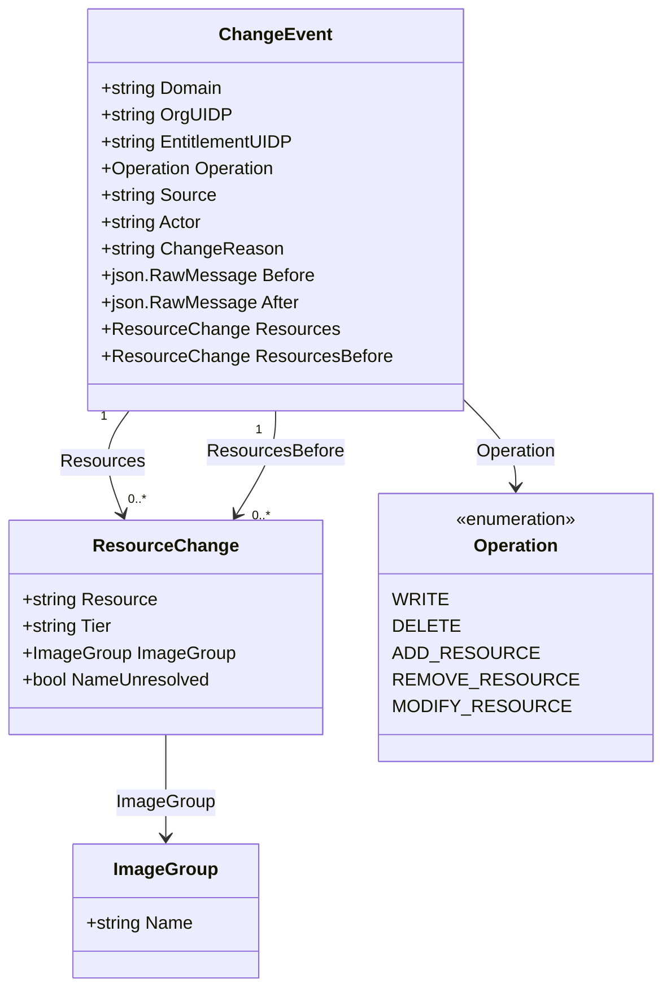
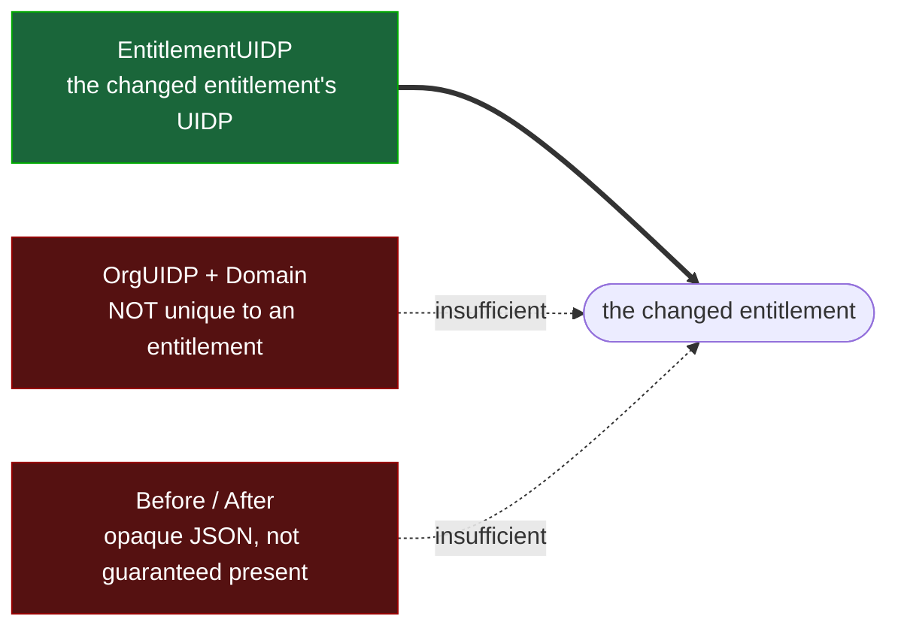
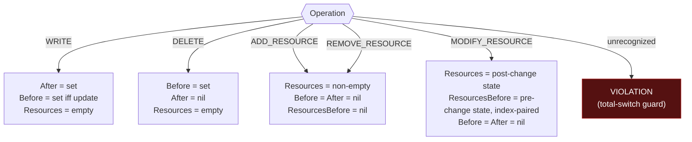

# `dev.chainguard.entitlement.changed.v1` — event contract

The authoritative contract for the CloudEvent emitted when an entitlement (or one
of its bound resources) changes. Subscribers program against **this document**;
the Go types in `entitlements.go` are its encoding.

---

## 1. Purpose & emit lifecycle

One event type serves every entitlement domain. The change timestamp lives on the
CloudEvent **envelope** (`time`), never in the body. The event is emitted **only on
a committed change**, to a **customer** audience — it is the raw mutation stream a
consumer can subscribe to for its own entitlements. It carries the change itself,
not a rendered notification payload.

A change that rolls back, and a write that resolves to a no-op, emit nothing.

### Envelope extension attributes (filtering)

Subscribers filter *without decoding the body* via CloudEvent **extension
attributes** (the `Extendable` / `CloudEventsExtension` convention). `ChangeEvent`
exposes:

| extension key | value | filter use |
|---|---|---|
| `GroupKey` | `OrgUIDP` | org-scoped subscriptions |
| `EntitlementDomainKey` | `Domain` | subscribe to one domain (e.g. `IMAGE`) |
| `EntitlementOperationKey` | `Operation` | subscribe to one change kind (e.g. `DELETE`) |

Any other key returns `("", false)`. These are envelope context attributes, not
body fields — the body still carries the full record (§2).

---

## 2. Structure

**`ResourceChange`** (json key order = struct order):

| field | json | required | meaning |
|---|---|---|---|
| `Resource` | `resource` | yes | the resource's own name (e.g. the repo name for IMAGE) |
| `Tier` | `tier` | optional (`omitempty`) | catalog tier, when applicable to the domain |
| `ImageGroup` | `image_group` | optional (`omitempty`) | the billed image group this resource belongs to (IMAGE domain, set by `SetResources`); nil means not a member |
| `NameUnresolved` | `name_unresolved` | optional (`omitempty`) | `true` iff `Resource` carries an identifier, not a name, because no name could be recovered (see below); omitted (false) otherwise |

There is **no resource UIDP**: no stable, customer-meaningful id exists for a
resource at emit time, so the resource **name** identifies it within its
entitlement. `Resources` may carry one or many entries for a resource-grain change,
so consumers must handle both.

One narrow exception: a `REMOVE_RESOURCE` for a resource whose underlying
source record was itself hard-deleted (not the usual soft-delete) carries that
record's own identifier in `Resource` in place of a name, since no name is
recoverable — this still must be logged and emitted, not silently dropped
(§7). `NameUnresolved` (above) is set on exactly this case, so a consumer
does not have to guess whether `Resource` is a name.

**`ImageGroup`**:

| field | json | meaning |
|---|---|---|
| `Name` | `name` | the image group's display name |

There is deliberately no external identifier for the group here. The
registry's read RPCs do return one (`external_image_group_id` on
`ListEntitlementCatalogImages` and `GetEffectiveEntitlements`); this event
keeps it off the wire (§8) — which upstream record defines the group is not
part of what changed — so rather than carry a field that would always be
empty, the type has no place for it.

Presence is the membership signal — an absent `ImageGroup` means the resource
does not belong to one, rather than a separate boolean that could disagree with
the name/id fields.

---

## 3. Identity — "which entitlement changed"

The subject is identified by the top-level **`EntitlementUIDP`**. Nothing else in the
event is a reliable entitlement identifier:

| field | json | required | meaning |
|---|---|---|---|
| `Domain` | `domain` | yes | canonical domain token (§6) |
| `OrgUIDP` | `org_uidp` | yes | owning organization |
| `EntitlementUIDP` | `entitlement_uidp` | yes (**every** Operation) | the changed entitlement's UIDP |
| `Operation` | `operation` | yes | the change kind (§5) |

For resource-grain operations (`ADD_RESOURCE` / `REMOVE_RESOURCE` /
`MODIFY_RESOURCE`), `EntitlementUIDP` is the owning entitlement the resources
belong to.

---

## 4. Attribution — "who made the change"

Distinct from the emit-time caller on the `events.Occurrence` envelope: these fields
describe the surface and originator this change is *attributed* to. `Source` here is
the **change surface** — the surface that made this change — **not** the
entitlement's system of record (its managing/owning source), which is carried on the
`Before`/`After` snapshot's own `source` field. These are two distinct uses of
`EntitlementSource`; the shared name is a known overload, tracked for a rename in
CUS-1263.

| field | json | meaning |
|---|---|---|
| `Source` | `source` | the surface that made this change (e.g. `CONSOLE_ADMIN` for an admin edit of an SFDC-managed grant), so a subscriber can spot an unexpected editor. `EntitlementSource` leaf name, `ENTITLEMENT_SOURCE_` prefix stripped (§6). Required on every write, so it is never `UNSPECIFIED`. |
| `Actor` | `actor` | identity the change is attributed to. **Redacted on the wire** (§8) |
| `ChangeReason` | `change_reason` | free-text reason recorded with the change. **Redacted on the wire** (§8) |

`Actor` and `ChangeReason` are blanked on the emitted event; `Source` (the change
surface) is emitted. The entitlement's own system-of-record source is on the
snapshot, not here. See §8.

---

## 5. Operation grain rules

`Domain`, `OrgUIDP`, `EntitlementUIDP`, `Operation` are **always set**. Beyond that,
each Operation populates exactly its own fields:

| Operation | Before | After | Resources | ResourcesBefore | grain |
|---|---|---|---|---|---|
| `WRITE` | set iff update (nil ⇒ create) | **set** | empty | nil | entitlement |
| `DELETE` | **set** | nil | empty | nil | entitlement |
| `ADD_RESOURCE` | nil | nil | **non-empty** | nil | resource |
| `REMOVE_RESOURCE` | nil | nil | **non-empty** | nil | resource |
| `MODIFY_RESOURCE` | nil | nil | **non-empty** (post-change) | **non-empty** (pre-change, index-paired with `Resources`) | resource |

`MODIFY_RESOURCE` is emitted only by a wholesale reconcile (`SetResources`),
the only writer *on this stream* of a bound resource's tier and image-group
fields, for a resource that stays bound but whose content changed. Writers
that have not yet moved onto the centralized service (today: the Salesforce
import and the GitHub reconciler) still change those same fields through
the legacy registry path, which emits nothing here — so until they cut
over, a tier or group change can happen with no `MODIFY_RESOURCE` at all
(§7's completeness caveat applies). The operation exists because two
independent, unordered `ADD_RESOURCE`/`REMOVE_RESOURCE` events cannot
reliably be read back as one in-place change (§7) — nor can a re-read of
`GetEffectiveEntitlements` disambiguate it: its `active_images` is
deduplicated across entitlements, reporting only the latest-expiring
attachment's tier and group fields, so a change on any other attachment is
invisible there. The same operation also covers a resource staying bound
while its underlying source record is replaced outright — a catalog repo
soft-deleted and recreated under its unchanged name, with the entitlement
rebound to the new record in the same call. `ResourcesBefore` and
`Resources` may then be equal: the hazard a same-name
`REMOVE_RESOURCE`/`ADD_RESOURCE` pair poses is the same whether or not the
resource's own content changed, so this case is still `MODIFY_RESOURCE`,
not a no-op. `ResourcesBefore` and `Resources` can also be equal on the wire
for a reason with nothing to do with either of those: the decision to emit
is made against the full stored group record, which carries the external
group identifier this type doesn't (§2) — a `Set` that changes only that
identifier is a real change by that comparison, so it still bumps the
version, logs, and emits, even though `Resources` and `ResourcesBefore` show
identical `Name`s. The change log (internal to the service) carries the full
before/after state including the field that actually changed; the event
does not.

Consumers must treat an unrecognized **`Operation`** *or* an unrecognized **`Domain`**
as a signal to re-fetch authoritative state (or log-and-skip) — never to silently
discard the change. Both vocabularies may grow in minor versions (§6), so an older
subscriber seeing a value it doesn't know is an expected, live case.

---

## 6. Vocabulary

| token class | source | note |
|---|---|---|
| `Operation` | SDK constants | the event's own closed set |
| `Domain` | SDK constants (`DomainImage` / `DomainLibrary` / `DomainPackage` / `DomainHelmChart` / `DomainFeature`) | the public token for each entitlement domain — the domain enum's leaf name, `ENTITLEMENT_DOMAIN_` prefix stripped |
| `Source`, `Tier` | the `EntitlementSource` / `CatalogTier` enum leaf names, **by reference** | not duplicated as SDK constants, since those enums grow. `Source` strips the `ENTITLEMENT_SOURCE_` prefix; `CatalogTier` leaves carry no prefix (e.g. `APPLICATION`) |

---

## 7. Delivery & ordering

Delivery is **best-effort and unordered** today. The event is published on a
detached, bounded-retry send after the write commits; a process exit before the
send, a sink that stays unavailable past the retries, or a publisher already
saturated by a stalled sink drops that event with no replay. The durable record of
every change is the per-domain `entitlement_change_log` in MySQL, written in the same
transaction as the change — the event stream is a derivative of it, not the source of
truth. Restoring an at-least-once guarantee via a
transactional outbox (publish from the log) is tracked in CUS-1264.

Therefore:

- Consumers **must not** treat this stream as complete: an event may be
  missing. For the entitlement grain (`WRITE`/`DELETE`), reconcile against
  `GetEffectiveEntitlements` rather than relying on delivery. For the
  resource grain (`ADD_RESOURCE`/`REMOVE_RESOURCE`/`MODIFY_RESOURCE`),
  the registry's `GetEffectiveEntitlements` cannot stand in: its
  `active_images` is deduplicated across entitlements, reporting only the
  latest-expiring attachment's tier and group fields, so it shows neither
  which entitlement a resource is bound under nor a change on any other
  attachment. No RPC returns a single entitlement's bound-resource set from
  the centralized service, and the entitlement change log is internal, not
  exposed by any RPC. Reconcile instead against the registry's own
  `ListEntitlementCatalogImages` (`public/sdk/proto/platform/registry/v1`),
  called with the entitlement as `parent`: it returns that entitlement's
  bound images with their current tier and group membership.
- Consumers **must be idempotent** — an event may also arrive more than once.
- Consumers **must not** apply `WRITE` as a positional delta off `Before`; on any
  `WRITE` (or on doubt) **re-fetch** authoritative state via `GetEffectiveEntitlements`.
- A `WRITE` in the `LIBRARY` domain also follows a change to the grant's serving
  tiers, which the snapshot does not carry: its `Before` and `After` differ only
  in `version_token` and `updated_at`.
- No cross-event ordering is guaranteed; do not assume a `DELETE` follows its `WRITE`.
- A resource that stays bound but whose tier or image-group fields change is
  `MODIFY_RESOURCE`, not an `ADD_RESOURCE`/`REMOVE_RESOURCE` pair: two
  independent, unordered CloudEvents could be read out of order — an `ADD`
  observed before its paired `REMOVE` would momentarily look like a *second*,
  distinct resource rather than a changed one — and even read in order,
  neither event alone carries enough to tell "modified" apart from "unbound
  then rebound unchanged". `MODIFY_RESOURCE` carries both states directly
  (`ResourcesBefore`/`Resources`, index-paired), so no re-fetch is needed for
  this case specifically.
- **Known gap**: a name can briefly be bound under more than one source
  record at once — a catalog repo soft-deleted and recreated (possibly more
  than once), with the entitlement still bound to one or more of the stale
  records (a state the registry's own group-removal checks already handle).
  `SetResources` collapses one same-name remove+add pair into `MODIFY_RESOURCE`
  *within a call*, but two gaps remain: (1) if the current record was already
  bound *before* that call (e.g. by a prior `AddResources` under the
  recreated name), dropping the stale record emits a plain `REMOVE_RESOURCE`
  for the name even though it remains bound; (2) if *two or more* stale
  records share the name, only one pairs into the `MODIFY_RESOURCE` — the
  rest emit as plain `REMOVE_RESOURCE`s for the same name, in the *same*
  call as that `MODIFY_RESOURCE`. In both cases a consumer applying these as
  independent, unordered deltas can process a `REMOVE_RESOURCE` after the
  paired `MODIFY_RESOURCE` and conclude the name is unbound while it remains
  bound. A consumer that must not miss this should reconcile against
  `ListEntitlementCatalogImages` rather than trust the event alone for either
  sequence.

The event carries no dedup key of its own; a consumer that needs strict dedup can
use the CloudEvent envelope `id`.

---

## 8. Audience & redaction

Emitted to a **customer** audience: the entitlement is the consumer's own product.
`Actor` and `ChangeReason` are **redacted (blanked)** on the wire, because they can
carry internal identities and free-text notes for changes made on the consumer's
behalf. The `Before` / `After` snapshots are emitted (the consumer's own entitlement
state) but with two internal fields stripped: nested `change_attribution`, and
`external_id` — the writer's key, which for SFDC-managed grants is a Salesforce
opportunity ID; `EntitlementUIDP` already identifies the entitlement. The top-level
`Source` (the change surface, §4) is emitted. One level down, the group's
external identifier — which the registry's read RPCs do return as
`external_image_group_id` — is kept off this event: `ResourceChange.ImageGroup`
(§2) has no field for it, so there is nothing to redact after the fact.

---

## 9. Wire shape & compatibility

- Exact JSON keys are stable; key order follows struct declaration order.
- **Additive-only** evolution: new fields are added `omitempty` where optional.
  Existing key spellings never change — a rename ships as a new event version
  (`...changed.v2`).
